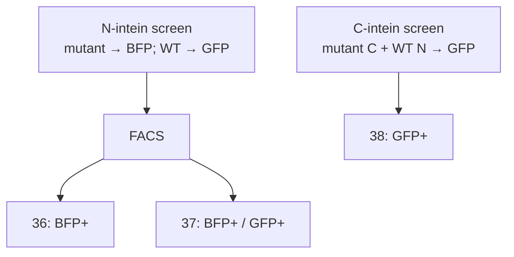
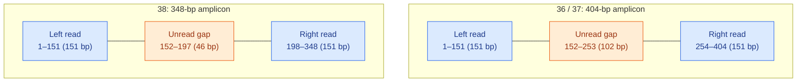

# Split-intein screening: post-FACS sequencing

This analysis identifies **N-intein and C-intein variants** in three FACS-sorted cell populations and estimates their relative abundance.

## 1. The experiment

Each library is a pool of plasmids. The intended design is **one amino-acid substitution per plasmid**.

| Library | Mutated positions | Possible variants |
|---|---|---:|
| N-intein (5′) | Amino acids 2–102 | **1,919** (101 × 19) |
| C-intein (3′) | Amino acids 2–35 | **646** (34 × 19) |

In the **N-intein screen**, the mutant N-intein is linked to BFP and the WT N-intein to GFP. They compete for a WT C-intein partner. Fluorescence appears when trans-splicing reconstitutes the corresponding reporter.

In the **C-intein screen**, the N-intein is WT and the C-intein is mutated. Successful trans-splicing reconstitutes GFP.



| Sample | FACS population | What it shows |
|---|---|---|
| **36** | **BFP+** | The mutant-associated reporter is detected. |
| **37** | **BFP+ / GFP+** | Both mutant- and WT-associated reporters are detected. |
| **38** | **GFP+** | A C-intein variant is present in cells with reconstituted GFP. |

Samples **36 and 37** contain the same N-intein library and can be compared. Sample **38** comes from a different library and assay. For the examples below, we assume **36 is BFP+ / GFP− (BFP-only)** and the 36 and 37 gates do not overlap. This needs confirmation from the original FACS gates.

## 2. Sequencing and variant filtering

We amplified the intein-containing part of each plasmid by PCR. This product is the **amplicon**: it includes the intein and some surrounding DNA. Sequencing reads are about **151 bp from each end** (paired-end).

| Samples | Amplicon length | Intein within the amplicon |
|---|---:|---|
| **36, 37** | 404 bp | N-intein: bases 29–334 (306 bp) |
| **38** | 348 bp | C-intein: bases 121–228 (108 bp) |

We aligned the reads to the **WT amplicon** with `minimap2`, counted variant events with GATK `AnalyzeSaturationMutagenesis`, and used `parse_gatk_single_aa.py` to keep events compatible with **one amino-acid substitution**.

For example, **L2A** changes the codon `CTG` to `GCC`. This requires three nucleotide substitutions, but changes only **one amino acid**. The parser accepts these changes because they are in the same codon. It rejects records with additional observed changes outside that codon. Changes in DNA that was **not read** cannot be ruled out.

**Example: L2F can come from two different DNA codons.** The WT codon at position 2 is `CTG` (leucine). Both changes below produce phenylalanine (F) at **the same amino-acid position**:

| DNA change | Protein variant |
|---|---|
| `CTG → TTC` | `L2F` |
| `CTG → TTT` | `L2F` |

Suppose GATK reports **100 observations** of the first change and **50** of the second. The parser checks each event separately, then reports **one `L2F` row with `gatk_count = 150`**. It does **not** combine changes from different DNA molecules. Any additional **observed** change outside codon 2 is excluded. The two DNA sequences simply encode the same protein substitution. Their frequencies are calculated separately before being added, as explained below.

## 3. Dominant paired-end sequencing geometry

Each amplicon is longer than the two **151-bp reads** combined. In the most common alignment pattern, one read covers the left end and its mate covers the right end of the same DNA fragment. **The bases between them are not sequenced by that pair.**



*Simplified view, not to scale. "Left" and "right" refer to positions on the reference, not necessarily to R1 and R2 labels.*

The gap falls **inside the intein** in both screens:

- **36 / 37:** N-intein = bases **29–334**; unread gap = **152–253** (amino acids 42–75).
- **38:** C-intein = bases **121–228**; unread gap = **152–197**.

Other read pairs can cover some of these middle bases, but coverage there is much lower. Importantly, **`molecules_covering` does not mean that every base in the region was sequenced**: GATK can count the span of a read pair across the gap. Variant frequencies in the middle can therefore appear artificially low. This matters when comparing variants from different positions.

## 4. Main results

| Sample | Designed variants | Variants detected |
|---|---:|---:|
| **36** | 1,919 | **1,918** |
| **37** | 1,919 | **1,917** |
| **38** | 646 | **646** |

Nearly all designed substitutions were observed in the selected pools. Each output TSV also contains rows for possible variants with **zero observed count**.

## 5. How to read the output tables

| Column | Meaning |
|---|---|
| `variant` | Protein substitution (e.g. `L2A`: leucine → alanine at position 2). |
| `gatk_count` | GATK observations supporting that substitution, **not** distinct cells or original plasmids. |
| `gatk_frequency_percent` | Estimated frequency of that substitution within the sequenced pool. |
| `min_molecules_covering`, `max_molecules_covering` | Smallest and largest GATK denominators contributing to that protein variant. |
| `alt_codons_observed` | Different DNA codons observed for the same protein substitution. |
| `n_gatk_records` | Number of accepted GATK records grouped into that substitution. |

**Real example: L2A**

| | **36** | **37** |
|---|---:|---:|
| `gatk_count` | 1,437 | 2,166 |
| `molecules_covering` | 2,845,684 | 3,236,447 |
| **`gatk_frequency_percent`** | **0.05050%** | **0.06693%** |

For this variant, each sample has one accepted GATK record:

$$
\text{Frequency (\%)} =
100 \times
\frac{\text{gatk\_count}}{\text{molecules\_covering}}
$$
L2A is **0.06693 / 0.05050 ≈ 1.33 times** as frequent in pool 37 as in pool 36. This is a comparison of **pool composition**, not a comparison of the number of cells.

For protein variants supported by several alternative codons, the parser **sums the accepted record frequencies** (`count / molecules_covering` for each record). Their denominators may differ, so `gatk_count / min_molecules_covering` or `/ max_molecules_covering` is **not** the final frequency.

## 6. How to identify candidate variants

The starting library may not contain equal amounts of every variant. To see which variants were favored by FACS, we need to compare each sorted pool with its **matching pre-FACS input library**:

$$
E_{36}=\frac{f_{36}}{f_{\mathrm{input}}}, \qquad
E_{37}=\frac{f_{37}}{f_{\mathrm{input}}}
$$

We need the N-intein input for **36 and 37**, and the C-intein input for **38**. Input and sorted samples should be processed in a comparable way. An enriched variant is a **candidate associated with the selected phenotype**, not proof of better performance than WT.

### Why a variant can become more frequent after sorting

Imagine **1,000 cells before FACS** and **100 cells collected afterward**. For simplicity, assume one variant per cell:

| | Before FACS (input) | After FACS |
|---|---:|---:|
| Total cells | 1,000 | 100 |
| Cells carrying L2A | 10 | 5 |
| **L2A frequency** | **1%** | **5%** |

L2A went from **10 cells to 5**, so its absolute number **decreased**. But its share of the population rose from **1% to 5%**:

$$
E_{L2A}=\frac{5\%}{1\%}=5
$$

This is **5-fold enrichment**: L2A was proportionally more common in the selected pool. It does not mean the variant multiplied or became five times more active. In our real data, NGS measures DNA observations, **not cell counts**; the example only illustrates why the starting proportion matters.

### Example: three N-intein variants

**Hypothetical numbers**, assuming sample 36 is BFP-only.

| Variant | Input | 36 (BFP-only) | 37 (Double+) | Enrichment 36 | Enrichment 37 |
|---|---:|---:|---:|---:|---:|
| **A** | 0.05% | 0.20% | 0.06% | **4×** | 1.2× |
| **B** | 0.05% | 0.06% | 0.20% | 1.2× | **4×** |
| **C** | 0.05% | 0.15% | 0.15% | 3× | 3× |

- **A:** mainly enriched in **36**. A candidate for the BFP-only phenotype, which *could* indicate an advantage of the mutant in the competition assay.
- **B:** mainly enriched in **37**. Associated with cells where both reporters are detected; this does **not** mean equal activity.
- **C:** enriched in **both**. No clear preference for one gate.

We can also compare the two pools directly:

$$
R=\frac{E_{36}}{E_{37}}=\frac{f_{36}}{f_{37}}
$$

For **A**, `R = 4 / 1.2 = 3.33`: A is relatively more represented in 36 than in 37. This ratio can be calculated from the two sorted pools alone because the common input cancels. **It is not a fold-change in trans-splicing activity.**

## 7. Why FACS positivity is not enough to judge activity

A FACS gate uses a fluorescence **threshold**. Two double-positive cells can have very different signals.

The numbers below are **hypothetical**, with a positivity threshold of **50 arbitrary units** for each reporter.

| Cell | BFP (mutant) | GFP (WT) | FACS result |
|---|---:|---:|---|
| **A** | 100 | 95 | Double-positive |
| **B** | 200 | 55 | Double-positive |
| **C** | 200 | 40 | BFP-only |

A and B are both double-positive, despite having different fluorescence patterns. C is classified as GFP-negative because its GFP signal is **below the threshold**, not necessarily absent.


## 8. Summary

The three post-FACS NGS datasets identify **which variants are present** and estimate **their relative frequencies** in the selected populations. Comparing 36 and 37 describes differences between the N-intein FACS pools; sample 38 belongs to a separate C-intein screen.

**Enrichment helps prioritize candidates**, but it does not measure how much better a variant performs than WT. Interpretation also depends on the FACS gates, reliable co-transfection, and incomplete sequencing coverage. **A direct, controlled functional test against WT** is needed to demonstrate improved trans-splicing.

## 9. Output files

```text
36_gatk_single_aa.tsv
37_gatk_single_aa.tsv
38_gatk_single_aa.tsv
```

